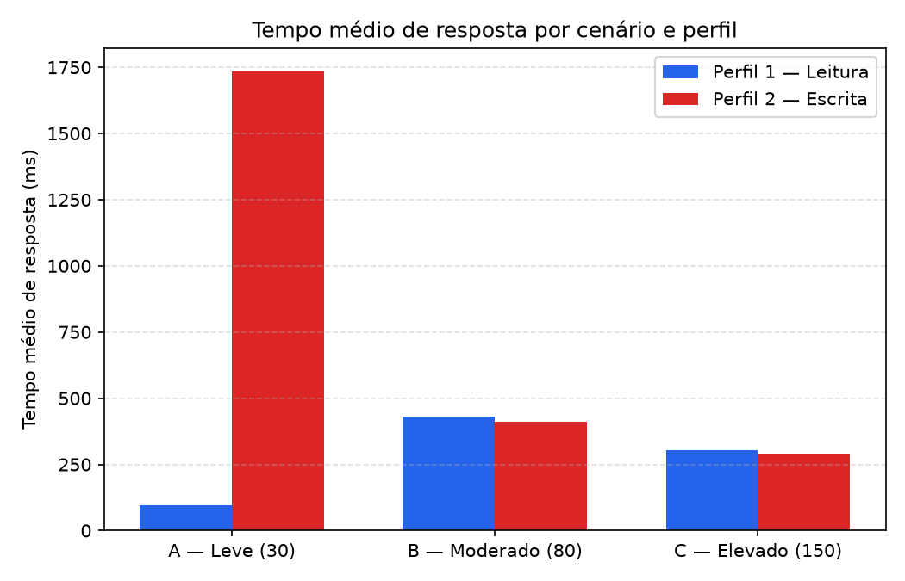
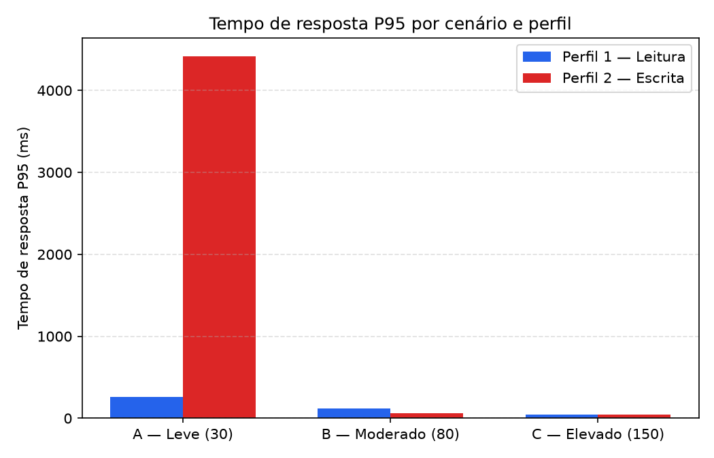
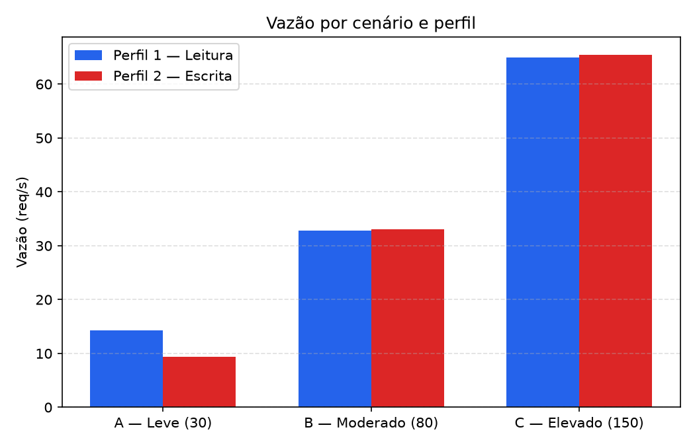
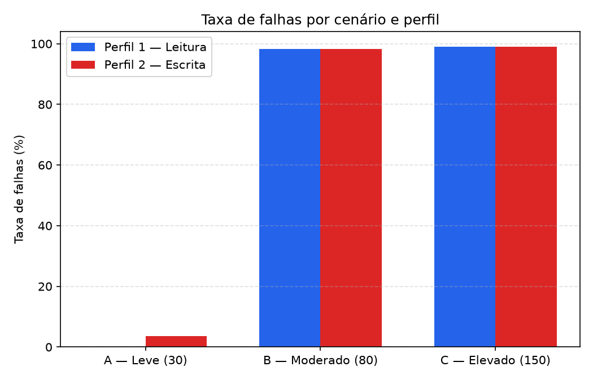
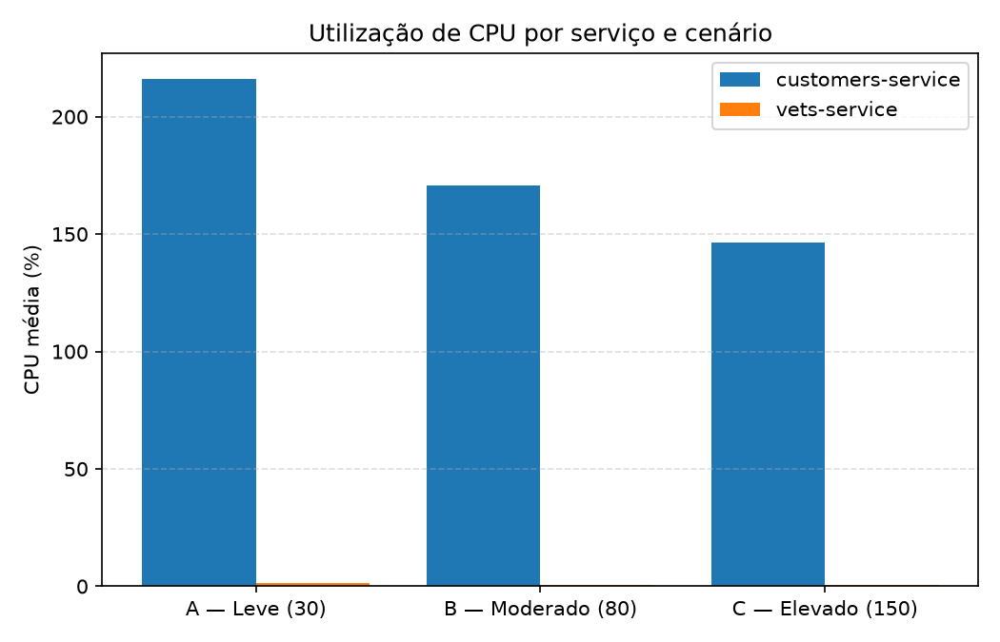

# SD-Locust-06

### Discente: Samuel Torres Vieira da Silva
### Matricula: 20249014475
### Link video demonstrativo: [https://youtu.be/qNI_EZ6E1J8]


Experimento de teste de carga do Spring PetClinic Microservices utilizando
[Locust](https://locust.io/). O objetivo foi observar como diferentes níveis
de concorrência e dois perfis de uso afetam tempo de resposta, vazão, falhas e
consumo de CPU dos serviços.

## 1. Introdução

Foram avaliados três cenários de carga:

| Cenário | Classificação | Usuários simultâneos |
|---|---|---:|
| A | Leve | 30 |
| B | Moderado | 80 |
| C | Elevado | 150 |

Cada cenário foi executado com os perfis `leitura` e `escrita`, em dez
repetições. O teste utiliza a aplicação PetClinic acessível em
`http://localhost:8080` por padrão e monitora os containers
`customers-service` e `vets-service`.

## 2. Reprodução

### Pré-requisitos

- Python 3;
- Docker e Docker Compose;
- Bash (Linux, WSL ou Git Bash no Windows);
- aplicação Spring PetClinic Microservices em execução;
- containers com os nomes `customers-service` e `vets-service`, para a coleta
  de CPU.

Instale as dependências do projeto:

```bash
python -m venv .venv
source .venv/bin/activate       # Linux/WSL
# No Windows PowerShell: .venv\Scripts\Activate.ps1
pip install -r requirements.txt
```

Inicie a aplicação conforme o repositório da PetClinic e confirme que ela está
disponível em `http://localhost:8080`. Para executar uma única combinação:

```bash
bash scripts/run_single.sh A leitura 1
bash scripts/run_single.sh C escrita 10 http://localhost:8080
```

Os argumentos são:

```text
run_single.sh <A|B|C> <leitura|escrita> <repetição> [base_url]
```

Para reproduzir toda a bateria de 60 execuções (3 cenários x 2 perfis x 10
repetições):

```bash
bash scripts/run_all_experiments.sh http://localhost:8080
```

Cada execução dura 420 segundos: 60 segundos de aquecimento e 360 segundos de
medição. Ao final, agregue os dados e gere novamente os gráficos:

```bash
python scripts/aggregate_results.py
python scripts/generate_graphs.py
```

Os dados brutos ficam em `results/raw/`, os dados agregados em
`results/processed/` e os gráficos em `results/graphs/`.

## 3. Descrição do ambiente

| Item | Especificação |
|---|---|
| Sistema operacional | Windows |
| Processador  | AMD Ryzen 7 5700U |
| Memória RAM | 12 GB |
| Placa gráfica | AMD Radeon(TM) Graphics |
| Armazenamento | 477 GB |
| Versão do Locust | 2.20 |
| URL da aplicação testada | `http://localhost:8080` |

### Configuração da carga

O arquivo [`locustfile.py`](./locustfile.py) define dois perfis:

- **Leitura:** 45% `GET /api/customer/owners`, 35%
  `GET /api/customer/owners/{id}`, 15% `GET /api/vet/vets` e 5%
  `POST /api/customer/owners`.
- **Escrita:** 20% `GET /api/customer/owners`, 20%
  `GET /api/customer/owners/{id}`, 20% `GET /api/vet/vets` e 40%
  `POST /api/customer/owners`.

Cada usuário aguarda entre 1 e 3 segundos entre tarefas. O ramp-up ocorre em
aproximadamente 10 segundos. As estatísticas do Locust são zeradas após o
período de aquecimento, de modo que as métricas representam a janela de
medição de seis minutos.

## 4. Metodologia

1. Foram selecionados os níveis de 30, 80 e 150 usuários simultâneos.
2. Para cada nível, foram executados os perfis de leitura e escrita.
3. Cada combinação foi repetida dez vezes, totalizando 60 execuções.
4. Durante cada execução, o Locust registrou contagem de requisições, falhas,
   tempo médio, P95 e vazão.
5. O script `monitor_cpu.sh` coletou, a cada dois segundos, a CPU dos serviços
   `customers-service` e `vets-service`.
6. As amostras de CPU dos primeiros 60 segundos foram descartadas.
7. O script [`aggregate_results.py`](./scripts/aggregate_results.py) calculou a
   média das dez repetições por cenário e perfil.
8. Os gráficos foram gerados pelo script
   [`generate_graphs.py`](./scripts/generate_graphs.py).

As métricas agregadas apresentadas a seguir são médias das repetições. Como as
execuções B e C tiveram muitas requisições com falha, o tempo médio dessas
execuções deve ser interpretado junto com a taxa de falhas e o P95: respostas
rápidas de erro podem reduzir a média, sem representar melhora real do
serviço.

## 5. Resultados

### 5.1 Resumo geral

| Cenário | Usuários | Perfil | Tempo médio (ms) | P95 (ms) | Vazão (req/s) | Taxa de falhas (%) |
|---|---:|---|---:|---:|---:|---:|
| A | 30 | Leitura | 95,37 | 259,0 | 14,27 | 0,00 |
| A | 30 | Escrita | 1.735,35 | 4.418,0 | 9,38 | 3,57 |
| B | 80 | Leitura | 431,65 | 116,4 | 32,83 | 98,24 |
| B | 80 | Escrita | 411,94 | 60,3 | 33,09 | 98,35 |
| C | 150 | Leitura | 303,05 | 45,1 | 64,99 | 98,99 |
| C | 150 | Escrita | 287,21 | 44,8 | 65,48 | 99,07 |

> Observação: os valores de P95 de B e C na tabela agregada são influenciados
> pela grande quantidade de respostas de falha. Por isso, não devem ser
> analisados isoladamente do percentual de falhas.

### 5.2 Consumo médio de CPU

| Cenário | Perfil | `customers-service` (%) | `vets-service` (%) |
|---|---|---:|---:|
| A | Leitura | 118,35 | 1,50 |
| A | Escrita | 314,05 | 1,02 |
| B | Leitura | 165,65 | 0,51 |
| B | Escrita | 175,57 | 0,49 |
| C | Leitura | 145,96 | 0,52 |
| C | Escrita | 147,09 | 0,53 |

### 5.3 Gráficos

#### Tempo de resposta



**Interpretação:** no cenário A, o perfil de leitura apresenta o menor tempo
médio, enquanto o perfil de escrita é significativamente mais lento. Nos
cenários B e C, as médias devem ser interpretadas junto da taxa de falhas,
pois muitas respostas rápidas de erro reduzem o valor médio observado.



**Interpretação:** o P95 evidencia melhor os casos mais lentos. O maior valor
ocorre no perfil de escrita do cenário A, indicando que as operações de
persistência possuem cauda de latência elevada mesmo antes da saturação. Em B
e C, a concentração de falhas altera a leitura desse indicador.

#### Vazão



**Interpretação:** a vazão nominal cresce com o número de usuários e atinge o
maior valor no perfil de escrita do cenário C (65,48 req/s). Esse crescimento
não representa necessariamente melhor desempenho, pois ocorre simultaneamente
com uma taxa de falhas próxima de 99%.

#### Taxa de falhas



**Interpretação:** o cenário A apresenta comportamento mais estável, com
nenhuma falha no perfil de leitura e poucas falhas no perfil de escrita. A
partir de 80 usuários, os cenários B e C apresentam saturação severa; o
cenário C possui a maior taxa de falhas nos dois perfis.

#### CPU dos serviços



**Interpretação:** o `customers-service` concentra o consumo de CPU em todos
os cenários, especialmente no perfil de escrita do cenário A. O
`vets-service` permanece com utilização baixa e relativamente estável, não
aparentando ser o principal gargalo do experimento.

## 6. Análise e respostas às questões

### 1. Como o aumento de usuários afeta o tempo de resposta?

Com 30 usuários, o perfil de leitura apresentou o melhor tempo médio
(95,37 ms) e nenhuma falha. O perfil de escrita já apresentou degradação
significativa no cenário A (1.735,35 ms e P95 de 4.418 ms), indicando que as
operações de criação são mais sensíveis mesmo sob carga leve.

Ao aumentar para 80 e 150 usuários, a aplicação entra em saturação: mais de
98% das requisições falham nos cenários B e C. Assim, embora as médias
agregadas de B e C apareçam numericamente menores que a média de A-escrita,
isso não significa que o sistema ficou mais rápido. O aumento de usuários
eleva a vazão oferecida, mas ultrapassa a capacidade de atendimento e reduz a
proporção de requisições concluídas com sucesso.

### 2. Qual perfil apresenta maior vazão?

O **perfil de escrita no cenário C** apresentou a maior vazão média:
**65,48 req/s**, seguido pelo perfil de leitura no mesmo cenário, com
64,99 req/s. Em carga leve, o perfil de leitura foi superior
(14,27 req/s contra 9,38 req/s), pois teve menos operações de escrita e
nenhuma falha.

Portanto, a maior vazão nominal ocorreu no perfil de escrita com 150 usuários,
mas esse resultado deve ser visto junto da taxa de falhas de **99,07%**.

### 3. Quais operações apresentam maior degradação?

As operações mais degradadas são:

- `GET /api/customer/owners`, que sofre com tempos elevados e grande volume de
  falhas nos cenários de maior carga;
- `POST /api/customer/owners`, especialmente no perfil de escrita, por
  envolver persistência e representar 40% das tarefas desse perfil;
- `GET /api/customer/owners/{id}` também apresenta degradação sob saturação,
  embora com impacto menor que a listagem e a criação.

A operação `GET /api/vet/vets` foi a mais estável nas amostras disponíveis,
com tempos menores e menor impacto relativo. A análise por endpoint pode ser
reproduzida consultando os arquivos `*_stats.csv` em `results/raw/`.

### 4. Como o consumo de CPU varia entre os cenários?

O maior consumo ocorreu no `customers-service`, enquanto o
`vets-service` permaneceu próximo de 0,5% a 1,5%. No cenário A, o perfil de
escrita atingiu a maior média observada no `customers-service` (314,05%),
coerente com o custo das operações de criação.

Nos cenários B e C, a CPU média do `customers-service` ficou entre
aproximadamente 145% e 176%. A redução em relação ao pico de A-escrita não
indica menor pressão efetiva: nesses cenários a alta taxa de falhas sugere
gargalo ou rejeição anterior à conclusão das operações. O `vets-service`
apresentou pouca variação e não aparenta ser o principal gargalo.

### 5. Qual cenário apresenta maior taxa de falhas?

O **cenário C, com 150 usuários**, apresentou a maior taxa de falhas:

- perfil de leitura: **98,99%**;
- perfil de escrita: **99,07%**.

O cenário B também apresentou saturação severa, com 98,24% e 98,35% de
falhas. Já o cenário A foi o único com comportamento predominantemente
funcional, com 0% de falhas em leitura e 3,57% em escrita.

## 7. Conclusões

Os resultados indicam que a capacidade observada do sistema é adequada para o
cenário leve, principalmente no perfil de leitura. O aumento para 80 usuários
já ultrapassa o ponto de operação estável, e 150 usuários agrava a situação,
produzindo a maior taxa de falhas.

O `customers-service` concentra o consumo de CPU e as operações de listagem e
criação de owners são as mais sensíveis à carga. A maior vazão nominal foi
obtida no cenário C, mas não deve ser considerada ganho de desempenho, pois
foi acompanhada por aproximadamente 99% de falhas. Como próximo passo, seria
recomendável investigar limites de conexão, banco de dados, filas, timeouts e
recursos do `customers-service`, além de repetir os testes após a correção
para comparar a capacidade sustentável de requisições bem-sucedidas.

## 8. Arquivos gerados

- [`results/processed/summary.csv`](./results/processed/summary.csv): resumo
  numérico por cenário e perfil.
- [`results/processed/summary.md`](./results/processed/summary.md): tabela
  pronta para consulta.
- [`results/processed/per_run.csv`](./results/processed/per_run.csv): dados de
  cada repetição.
- [`results/raw/`](./results/raw/): CSVs do Locust e da monitoração de CPU.
- [`results/graphs/`](./results/graphs/): gráficos usados neste relatório.
